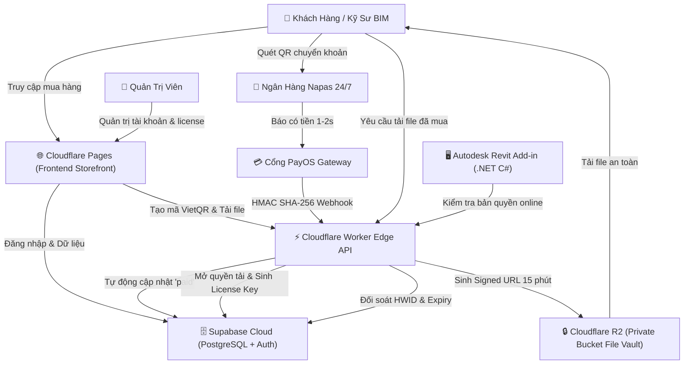

# HƯỚNG DẪN TRIỂN KHAI THỰC TẾ & VẬN HÀNH TOÀN DIỆN (BƯỚC 2)
# REVITSTORE HUB - PLATFORM BÁN REVIT FAMILY & REVIT TOOLS

Tài liệu này cung cấp quy trình từng bước để đưa website **RevitStore Hub** từ môi trường chạy thử nội bộ (Local Dev) lên **môi trường thực tế (Production)** trên nền tảng Serverless hiện đại với chi phí vận hành tối ưu **dưới 100.000 VNĐ/tháng**.

---

## 1. TỔNG QUAN KIẾN TRÚC VẬN HÀNH THỰC TẾ



---

## 2. BƯỚC 1: KHỞI TẠO CƠ SỞ DỮ LIỆU POSTGRESQL TRÊN SUPABASE (MIỄN PHÍ)

1. **Đăng ký tài khoản:**
   - Truy cập [https://supabase.com](https://supabase.com) và tạo tài khoản (có thể đăng nhập bằng GitHub).
2. **Tạo Project mới:**
   - Đặt tên Project: `revitstore-hub-production`.
   - Đặt mật khẩu cơ sở dữ liệu mạnh và chọn Data Center: **Singapore (Southeast Asia)** để đạt độ trễ thấp nhất về Việt Nam (~15-30ms).
   - Chọn gói **Free Plan** (Bao gồm: 500MB DB, 50.000 Monthly Active Users, Không giới hạn API requests).
3. **Chạy Script Khởi Tạo Bảng:**
   - Trong Dashboard Supabase, bấm vào menu **SQL Editor** (biểu tượng `>_` ở thanh menu bên trái).
   - Bấm **New Query**.
   - Mở file `supabase/schema.sql` trong thư mục dự án này, sao chép toàn bộ nội dung và dán vào SQL Editor.
   - Bấm **Run**.
   - *Kết quả:* Hệ thống sẽ tự động tạo đủ 10 bảng: `profiles`, `products`, `product_files`, `orders`, `order_items`, `user_purchases`, `licenses`, `license_activations`, `custom_requests`, `download_logs` cùng đầy đủ phân quyền bảo mật RLS (Row-Level Security) và dữ liệu mẫu.
4. **Lấy Khóa Kết Nối API:**
   - Vào mục **Project Settings ➔ API**:
     - `Project URL`: dạng `https://xyzcompany.supabase.co` ➔ Dùng cho biến `SUPABASE_URL`.
     - `anon / public key`: Dùng cho biến `SUPABASE_ANON_KEY`.
     - `service_role key` (Bảo mật tuyệt đối, không chia sẻ): Dùng cho biến `SUPABASE_SERVICE_ROLE_KEY` trong Cloudflare Worker.

---

## 3. BƯỚC 2: CẤU HÌNH KHO LƯU TRỮ FILE RIÊNG TƯ CLOUDFLARE R2

1. **Kích hoạt Cloudflare R2:**
   - Đăng nhập [Cloudflare Dashboard](https://dash.cloudflare.com) ➔ Chọn mục **R2 Object Storage**.
   - Gói miễn phí của R2 cung cấp **10 GB lưu trữ miễn phí** và đặc biệt là **0 VNĐ phí băng thông tải (Zero Egress Fee)**.
2. **Tạo Bucket Lưu Trữ:**
   - Bấm **Create Bucket**.
   - Đặt tên Bucket: `revit-vault-private`.
   - **LƯU Ý:** Để chế độ **Private**, KHÔNG bật *Public Access*. Mọi lượt tải về bắt buộc phải đi qua link có chữ ký số (Signed URL) 15 phút của Backend.
3. **Cấu Trúc Thư Mục Upload File Lên R2:**
   ```text
   revit-vault-private/
   ├── families/
   │   ├── pump-ahc-500/AHC_Vertical_InLine_Pump_v2024.rfa
   │   └── door-system-55/Xingfa_Door_System55_Parametric.rfa
   ├── templates/
   │   ├── RevitHub_MEP_HighRise_Template_v2024.rte
   │   └── RevitHub_Architectural_Villa_Template.rte
   └── tools/
       ├── MEP_Routing_Pro_v2.4.0_Setup.exe
       └── Batch_Sheet_Exporter_Setup.zip
   ```
4. **Tạo API Token R2 Cho Backend:**
   - Vào mục **R2 ➔ Manage R2 API Tokens ➔ Create API Token**.
   - Quyền: **Object Read & Write**.
   - Lưu lại: `Access Key ID` và `Secret Access Key`.

---

## 4. BƯỚC 3: TÍCH HỢP CỔNG THANH TOÁN TỰ ĐỘNG VIETQR PAYOS (NAPAS 24/7)

1. **Đăng ký tài khoản PayOS:**
   - Truy cập [https://payos.vn](https://payos.vn) và đăng ký tài khoản (Miễn phí 100% không mất phí duy trì cổng).
2. **Kết nối tài khoản ngân hàng thụ hưởng:**
   - Vào mục **Tài khoản thụ hưởng** ➔ Kết nối số tài khoản ngân hàng của bạn (MB Bank, Vietcombank, Techcombank, VPBank, ACB...). Tiền khách chuyển khoản sẽ vào thẳng tài khoản ngân hàng này ngay lập tức 24/7.
3. **Tạo Kênh Thanh Toán (Payment Channel):**
   - Vào mục **Kênh thanh toán ➔ Tạo kênh mới**.
   - Lấy 3 thông số bảo mật:
     - `Client ID`
     - `API Key`
     - `Checksum Key` (Dùng để xác thực chữ ký HMAC SHA-256 Webhook ngân hàng).
4. **Cài Đặt Webhook URL:**
   - Trong cấu hình Kênh thanh toán trên PayOS, điền URL nhận Webhook:
     `https://api.yourdomain.com/api/payment/webhook` (hoặc URL Worker: `https://revit-store-api.your-subdomain.workers.dev/api/payment/webhook`).

---

## 5. BƯỚC 4: TRIỂN KHAI CLOUDFLARE WORKER BACKEND API

1. **Cài đặt công cụ Wrangler CLI (Nếu chưa có):**
   ```bash
   npm install -g wrangler
   wrangler login
   ```
2. **Kiểm tra file cấu hình `wrangler.toml`:**
   ```toml
   name = "revit-store-api"
   main = "worker/index.js"
   compatibility_date = "2024-01-01"

   [vars]
   R2_BUCKET_NAME = "revit-vault-private"
   LICENSE_SECRET_SALT = "REVIT_STORE_PROD_SALT_9981"
   ```
3. **Thêm các biến bảo mật (Secrets) vào Cloudflare Worker:**
   ```bash
   wrangler secret put PAYOS_CLIENT_ID
   wrangler secret put PAYOS_API_KEY
   wrangler secret put PAYOS_CHECKSUM_KEY
   wrangler secret put SUPABASE_URL
   wrangler secret put SUPABASE_SERVICE_ROLE_KEY
   wrangler secret put R2_ACCESS_KEY_ID
   wrangler secret put R2_SECRET_ACCESS_KEY
   ```
4. **Tiến hành Deploy API lên mạng lưới toàn cầu:**
   ```bash
   wrangler deploy
   ```
   *Kết quả:* Bạn sẽ nhận được endpoint Worker hoạt động trên hơn 300 trung tâm dữ liệu của Cloudflare, sẵn sàng phục vụ Webhook và API kiểm tra bản quyền.

---

## 6. BƯỚC 5: TRIỂN KHAI GIAO DIỆN LÊN CLOUDFLARE PAGES

1. **Triển khai tự động qua Git (Khuyên dùng):**
   - Đẩy toàn bộ mã nguồn `revit-store-hub` lên kho GitHub / GitLab của bạn.
   - Vào [Cloudflare Dashboard](https://dash.cloudflare.com) ➔ Chọn mục **Workers & Pages ➔ Create application ➔ Pages ➔ Connect to Git**.
   - Chọn repository của bạn.
   - Build Settings:
     - Framework preset: **None** (Static HTML/CSS/JS).
     - Build output directory: `.` (hoặc để trống thư mục gốc).
   - Bấm **Save and Deploy**.
2. **Gắn Tên Miền Riêng (Custom Domain):**
   - Vào mục **Custom Domains** trong Cloudflare Pages:
   - Thêm tên miền: ví dụ `revitstore.vn` hoặc `bimtools.vn`.
   - Cloudflare sẽ tự động cấp chứng chỉ bảo mật **SSL/TLS miễn phí** trong vòng 2 phút.

---

## 7. BƯỚC 6: TÍCH HỢP REVIT ADD-IN .NET C#

File mã nguồn mẫu đã sẵn sàng tại: `examples/RevitAddinLicenseClient.cs`.

1. **Tích hợp vào Visual Studio C#:**
   - Mở dự án Revit Add-in (.NET Framework 4.8 hoặc .NET 8).
   - Thêm tệp `RevitAddinLicenseClient.cs` vào solution.
   - Thêm tham chiếu thư viện: `System.Management.dll` (để đọc Hardware ID).
2. **Kích hoạt trực tuyến khi người dùng mở lệnh Add-in:**
   ```csharp
   [Transaction(TransactionMode.Manual)]
   public class MyRevitCommand : IExternalCommand
   {
       public Result Execute(ExternalCommandData commandData, ref string message, ElementSet elements)
       {
           // 1. Lấy mã License Key mà người dùng đã lưu
           string userKey = AppSettings.Default.LicenseKey;

           // 2. Kiểm tra bản quyền trực tuyến
           var checkTask = LicenseVerificationService.ValidateLicenseAsync(userKey, "2025");
           checkTask.Wait();
           var result = checkTask.Result;

           if (!result.valid)
           {
               TaskDialog.Show("Yêu Cầu Bản Quyền", result.message + "\n\nVui lòng truy cập website https://revitstore.vn để gia hạn.");
               return Result.Cancelled;
           }

           // 3. Bản quyền hợp lệ -> Thực thi logic công cụ
           TaskDialog.Show("Xin chào", $"Chào mừng bạn sử dụng {result.product_name}! Còn lại {result.days_remaining} ngày sử dụng.");
           
           // Thực thi các lệnh tự động hóa BIM của bạn...
           return Result.Succeeded;
       }
   }
   ```
3. **Kích hoạt ngoại tuyến bằng file `.lic`:**
   ```csharp
   // Khi người dùng chọn file license offline tải từ website về:
   var result = LicenseVerificationService.ValidateOfflineLicenseFile(@"C:\Licenses\MEP_Routing_License.lic");
   if (result.valid)
   {
       TaskDialog.Show("Kích Hoạt Offline Thành Công", $"Bản quyền {result.product_name} đã sẵn sàng!");
   }
   ```

---

## 8. DỰ TOÁN CHI PHÍ HÀNG THÁNG & SAO LƯU PHỤC HỒI

| Thành phần | Nhà cung cấp | Giới hạn Free Tier | Chi phí thực tế khi vận hành |
| :--- | :--- | :--- | :--- |
| **Website Storefront** | Cloudflare Pages | Băng thông không giới hạn, SSL miễn phí | **0 VNĐ** |
| **API Backend Services** | Cloudflare Workers | 100.000 lượt gọi / ngày | **0 VNĐ** |
| **Cơ sở dữ liệu & Auth** | Supabase PostgreSQL | 500 MB DB, 50.000 người dùng hoạt động | **0 VNĐ** |
| **Lưu trữ RFA / EXE Vault** | Cloudflare R2 | 10 GB miễn phí, 0đ phí tải ra ngoài | **0 VNĐ** |
| **Cổng VietQR Napas 24/7** | PayOS | Giao dịch tự động, Webhook tức thì | **0 VNĐ** |
| **Tên miền quốc tế (.vn/.com)**| Nhà đăng ký tên miền | Gia hạn 1 lần / năm (~250.000đ/năm) | **~21.000 VNĐ / tháng** |
| **TỔNG CHI PHÍ THÁNG** | — | — | **~21.000 VNĐ / tháng** |

> [!TIP]
> **Sao lưu dữ liệu định kỳ:**
> - Supabase tự động sao lưu hàng ngày. Bạn có thể bấm *Export Database* trong Supabase Dashboard bất kỳ lúc nào để tải file `.sql` về máy tính lưu trữ an toàn.
> - Các file Family (.RFA) và bộ cài Add-in được lưu trên Cloudflare R2 với độ bền 99.999999999% (11 số 9), đảm bảo không bao giờ bị mất mát dữ liệu.
